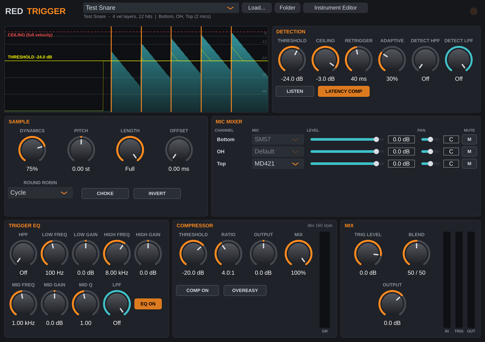

# Red Trigger

An insert drum-replacement / augmentation plugin (VST3, AU, Standalone) built with JUCE 8.
Put it on a single drum track (kick, snare, tom…). It detects the hits, plays a multisampled
trigger instrument, runs it through its own EQ and dbx 160-style compressor, and blends
the result with the original track.



## Download

Ready-to-install builds for macOS (AU / VST3 / Standalone, Apple Silicon + Intel) and
Windows (VST3 / Standalone) are produced automatically by GitHub Actions on every push and
published on the [Releases page](../../releases/tag/latest). On macOS, unzip and right-click
**Install Red Trigger.command → Open**.

## Building

Requirements: CMake ≥ 3.22, a C++17 compiler (Xcode on macOS, Visual Studio 2022 on Windows).
JUCE 8.0.4 is downloaded automatically.

macOS (universal arm64 + x86_64, builds AU + VST3 + Standalone):

```bash
cmake -S . -B build -G Xcode
cmake --build build --config Release
```

Windows:

```bash
cmake -S . -B build -G "Visual Studio 17 2022"
cmake --build build --config Release
```

Output: `build/RedTrigger_artefacts/Release/{AU,VST3,Standalone}`. Copy the plugin into
`~/Library/Audio/Plug-Ins/Components` (AU) or `~/Library/Audio/Plug-Ins/VST3`. On macOS, a plugin
you build yourself is signed ad-hoc and works on your own machine; to give it to other people you
need to sign and notarize it with an Apple Developer ID. AAX (Pro Tools) is not set up because it
needs Avid's SDK and a PACE signing account.

Tests: `cmake --build build --target RedTriggerTests && ./build/RedTriggerTests_artefacts/Release/RedTriggerTests`

## Signal flow

```
input ─┬─► detection filters (HPF/LPF) ─► transient detector ─► velocity ─► sample engine
       │                                                               (vel layers, round robin,
       │                                                                Direct / OH / Room mics)
       │                                                                        │
       │                                                          Trigger EQ (HPF, low shelf,
       │                                                          mid bell, high shelf, LPF)
       │                                                                        │
       │                                                       dbx 160-style compressor
       │                                                                        │
       │                                                        trigger level / polarity
       ▼                                                                        ▼
   dry (delayed by 3 ms if Latency Comp) ───────────── BLEND ──────────── trigger
                                                         │
                                                       output
```

## Controls

**Detection**
- **Threshold**: level that fires a hit. You can also drag the yellow line in the display.
- **Ceiling**: input level that maps to full velocity (127). Hits between threshold and
  ceiling are scaled across the velocity range.
- **Retrigger**: minimum time between hits.
- **Adaptive**: after a hit, the threshold jumps to this percentage of the hit's peak and then decays,
  which rejects bleed and ringing from the same hit. The dim yellow trace shows the effective threshold.
- **Detect HPF / LPF**: filters for the detector only. Example: HPF ≈ 150 Hz on a snare to ignore kick
  bleed, LPF ≈ 150 Hz on a kick to ignore the snare.
- **Listen**: hear the filtered detector signal while you set the filters.
- **Latency Comp**: the detector measures the peak for 3 ms after a hit begins. With this on, the
  dry signal is delayed by those 3 ms (and the plugin reports that latency to the host), so samples
  land on the original transient to the sample. With it off there is no latency, but samples are 3 ms late.

**Sample**
- **Dynamics**: 100% follows the input dynamics; 0% makes every hit full velocity.
- **Pitch** (±12 st), **Length** (fades the sample out early), **Offset** (delays the trigger by up to 20 ms).
- **Direct / Overhead / Room**: mic mixer for multi-mic instruments. Knobs for mics the instrument
  doesn't have are dimmed.
- **Round Robin**: Cycle, or Random (never repeats the same hit twice in a row).
- **Choke**: each new hit cuts off the previous one (3 ms fade).
- **Invert**: flips the trigger's polarity. Use it to fix phase against the dry track.

**Compressor (dbx 160 style)**: true-RMS detection with program-dependent attack (measured at
~17 / 6.5 / 3.8 ms for 10 / 20 / 30 dB over threshold, vs the hardware's spec of 15 / 5 / 3 ms)
and a constant 120 dB/s release. The ratio goes 1:1 → ∞:1 → -1:1 like the original
(negative ratios turn louder hits down). Also has an OverEasy soft knee, output gain and a parallel Mix.

**Mix**: Trigger Level, **Blend** (Dry ↔ Trigger), Output.

## Trigger instruments (.dtz)

### Building one in the plugin
1. Click **Instrument Builder**.
2. Drop a folder of one-shots (WAV/AIFF/FLAC) onto the page, or use Add Files / Add Folder.
3. Choose the layering mode:
   - **Sort by loudness**: every hit is measured, sorted by peak level, and split into the number of
     velocity layers you choose. The hits within a layer become round robins. You just need
     a folder of hits played at different strengths.
   - **From filenames**: `v1`, `v2`… (or `vel1`) pick the layer and `rr1`, `rr2`… the round-robin order.
4. Name it and click **Save Instrument…**. It's saved to `~/Music/Red Trigger/Instruments/`
   and loaded right away. Everything in that folder (including subfolders) shows up in the
   instrument menu.

**Multi-mic hits**: files with the same name apart from a mic token are combined into one hit:
`_OH` / `_Overhead` → Overhead, `_Room` / `_Amb` → Room, `_DI` / `_Close` / no token → Direct.
Subfolders named `OH` or `Room` also work (`Snare/Room/snare_v3_rr1.wav`). Samples can be mono or stereo,
and mics can have different sample rates (they're resampled when the instrument loads).

### File format
A `.dtz` is an ordinary zip file containing `instrument.xml` and a `samples/` folder:

```xml
<RedTriggerInstrument name="Snare A" version="1">
  <Layer velLo="1" velHi="42">
    <Hit direct="samples/snare_v1_rr1.wav" overhead="samples/snare_v1_rr1_OH.wav" room="samples/snare_v1_rr1_Room.wav"/>
    <Hit direct="samples/snare_v1_rr2.wav" overhead="..." room="..."/>
  </Layer>
  <Layer velLo="43" velHi="127"> ... </Layer>
</RedTriggerInstrument>
```

You can unzip it, adjust velocity ranges by hand, and zip it back up. You can also load a bare
`instrument.xml` directly (sample paths are relative to the XML file).
Sessions store the instrument's path. If the file has moved, the plugin looks for the same file name
in the instruments folder.

## Source layout
- `Source/dsp/` – `TransientDetector`, `Dbx160Compressor`, `TriggerEQ`, `Biquad` (header-only, no allocation in the audio thread)
- `Source/engine/` – `Instrument` (model + .dtz/.xml loader), `SampleEngine` (32-voice player, cubic interpolation)
- `Source/builder/` – `InstrumentBuilder` (filename parsing, loudness analysis, layering, .dtz writer)
- `Source/ui/` – look and feel, widgets, detector display, builder page
- `tests/Tests.cpp` – headless tests for the DSP, builder round-trip, engine, and the full processor (alignment, state)
