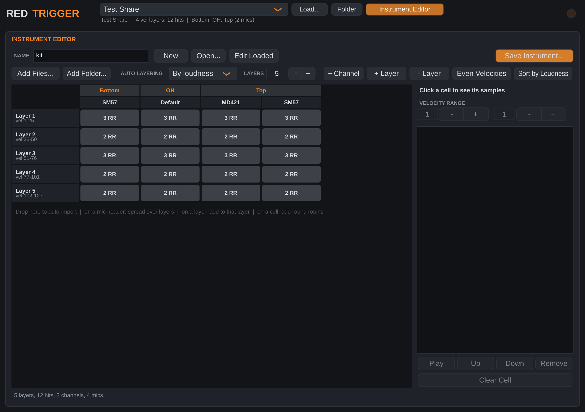

# Red Trigger

An insert drum-replacement / augmentation plugin (VST3, AU, Standalone) built with JUCE 8.
Put it on a single drum track (kick, snare, tom…). It detects the hits, plays a multisampled
trigger instrument, runs it through its own EQ and dbx 160-style compressor, and blends
the result with the original track.




## Download

Ready-to-install macOS builds (AU / VST3 / Standalone, Apple Silicon + Intel) are produced automatically by GitHub Actions on every push and
published on the [Releases page](../../releases/tag/latest). On macOS, unzip and right-click
**Install Red Trigger.command → Open**.

## Building

Requirements: CMake ≥ 3.22, a C++17 compiler (Xcode on macOS, Visual Studio 2022 on Windows).
JUCE 8.0.4 is downloaded automatically.

macOS (universal arm64 + x86_64, builds AU + VST3 + Standalone):

```bash
cmake -S . -B build -G Xcode
cmake --build build --config Release
```

Windows:

```bash
cmake -S . -B build -G "Visual Studio 17 2022"
cmake --build build --config Release
```

Output: `build/RedTrigger_artefacts/Release/{AU,VST3,Standalone}`. Copy the plugin into
`~/Library/Audio/Plug-Ins/Components` (AU) or `~/Library/Audio/Plug-Ins/VST3`. On macOS, a plugin
you build yourself is signed ad-hoc and works on your own machine; to give it to other people you
need to sign and notarize it with an Apple Developer ID. AAX (Pro Tools) is not set up because it
needs Avid's SDK and a PACE signing account.

Tests: `cmake --build build --target RedTriggerTests && ./build/RedTriggerTests_artefacts/Release/RedTriggerTests`

## Signal flow

```
input ─┬─► detection filters (HPF/LPF) ─► transient detector ─► velocity ─► sample engine
       │                                                               (vel layers, round robin,
       │                                                                Direct / OH / Room mics)
       │                                                                        │
       │                                                          Trigger EQ (HPF, low shelf,
       │                                                          mid bell, high shelf, LPF)
       │                                                                        │
       │                                                       dbx 160-style compressor
       │                                                                        │
       │                                                        trigger level / polarity
       ▼                                                                        ▼
   dry (delayed by 3 ms if Latency Comp) ───────────── BLEND ──────────── trigger
                                                         │
                                                       output
```

## Controls

**Detection**
- **Threshold**: level that fires a hit. You can also drag the yellow line in the display.
- **Ceiling**: input level that maps to full velocity (127). Hits between threshold and
  ceiling are scaled across the velocity range.
- **Retrigger**: minimum time between hits.
- **Adaptive**: after a hit, the threshold jumps to this percentage of the hit's peak and then decays,
  which rejects bleed and ringing from the same hit. The dim yellow trace shows the effective threshold.
- **Detect HPF / LPF**: filters for the detector only. Example: HPF ≈ 150 Hz on a snare to ignore kick
  bleed, LPF ≈ 150 Hz on a kick to ignore the snare.
- **Listen**: hear the filtered detector signal while you set the filters.
- **Latency Comp**: the detector measures the peak for 3 ms after a hit begins. With this on, the
  dry signal is delayed by those 3 ms (and the plugin reports that latency to the host), so samples
  land on the original transient to the sample. With it off there is no latency, but samples are 3 ms late.

**Sample**
- **Dynamics**: 100% follows the input dynamics; 0% makes every hit full velocity.
- **Pitch** (±12 st), **Length** (fades the sample out early), **Offset** (delays the trigger by up to 20 ms).
- **Round Robin**: Cycle, or Random (never repeats the same hit twice in a row).
- **Choke**: each new hit cuts off the previous one (3 ms fade).
- **Invert**: flips the trigger's polarity. Use it to fix phase against the dry track.

**Mic Mixer**: one strip per mic channel in the loaded instrument (e.g. Top, Bottom, OH, Room).
Each strip has:
- **Mic**: which microphone to use at that position, e.g. SM57 or MD421 on the snare top. Every mic
  at a position was recorded on the same strikes, so switching mics changes the tone, not the performance.
- **Level**, **Pan** and **Mute**.

All strip controls are automatable host parameters (`Ch 1 Mic`, `Ch 1 Level`, …) and are saved with the session.

**Compressor (dbx 160 style)**: true-RMS detection with program-dependent attack (measured at
~17 / 6.5 / 3.8 ms for 10 / 20 / 30 dB over threshold, vs the hardware's spec of 15 / 5 / 3 ms)
and a constant 120 dB/s release. The ratio goes 1:1 → ∞:1 → -1:1 like the original
(negative ratios turn louder hits down). Also has an OverEasy soft knee, output gain and a parallel Mix.

**Mix**: Trigger Level, **Blend** (Dry ↔ Trigger), Output.

## Trigger instruments (.dtz)

### Instrument Editor
Click **Instrument Editor**. The editor is a grid: **rows are velocity layers**, **columns are microphones**,
grouped under their mic position (channel). Each cell holds that layer's round robins for that mic.

Drag & drop anywhere:
| Drop on… | What happens |
|---|---|
| the empty grid / below the rows | **Auto-import**: channels, mics, velocity layers and round robins are all detected |
| a **mic column header** | the files are spread over the layers of that mic (by loudness or `v#` tags) |
| a **layer** (row header) | the files go into that layer; each file's channel/mic is detected |
| a **cell** | the files are added as round robins of that layer + mic |

Other controls:
- Right-click a column header to rename a channel or mic, add another mic to a position, or remove one.
- **+ Channel** adds a position. **+ Layer** / **- Layer**, **Even Velocities** and **Sort by Loudness**
  edit the layers. You can type a selected layer's velocity range in the side panel.
- Click a cell to list its samples. **Play** (or double-click) auditions a sample, and **Up/Down/Remove**
  reorder or delete round robins.
- **Open…** / **Edit Loaded** re-open a saved instrument for editing.
- **Save Instrument…** writes a single `.dtz` to `~/Music/Red Trigger/Instruments/` and loads it.

Auditioning plays through the plugin's output, so the host has to be processing the track. Some DAWs
(Logic, for example) only do that while the track is selected or record-armed.

**How auto-import reads names.** Folder names (below the folder you dropped) and file names are split into words:
- **Mic positions**: `Top`, `Bottom`/`Btm`, `OH`/`Overhead`, `Room`/`Amb`, `In`, `Out`, `Sub`, `DI`/`Close`,
  plus any channel names you've already created in the editor.
- **Mic models**: `SM57`, `57`, `MD421`, `421`, `C414`, `D112`, `Beta91`, `U47`, `U87`, `KM184`, `R121`, `e906`…,
  plus any mic names you've already created.
- `v1`, `v2`… pick velocity layers in "By v#/rr# tags" mode, and `rr1`, `rr2`… set the round-robin order.
- Files that differ only by position/mic words are the **same strike**, so they line up on the same round robin.

Example layout that imports cleanly:
```
Snare/
  Top/SM57/snare_v1_rr1.wav     Top/MD421/snare_v1_rr1.wav
  Bottom/snare_v1_rr1_SM57.wav  OH/snare_v1_rr1.wav  Room/snare_v1_rr1.wav
```

### File format
A `.dtz` is an ordinary zip file containing `instrument.xml` and a `samples/` folder:

```xml
<RedTriggerInstrument name="Snare A" version="2">
  <Channel name="Top"><Mic name="SM57"/><Mic name="MD421"/></Channel>
  <Channel name="Bottom"><Mic name="SM57"/></Channel>
  <Channel name="OH"><Mic name="C414"/></Channel>
  <Layer velLo="1" velHi="42">
    <Hit peakDb="-14.2">
      <Sample channel="0" mic="0" file="samples/snare_top_sm57_v1_rr1.wav"/>
      <Sample channel="0" mic="1" file="samples/snare_top_md421_v1_rr1.wav"/>
      <Sample channel="1" mic="0" file="samples/snare_bottom_v1_rr1.wav"/>
      <Sample channel="2" mic="0" file="samples/snare_oh_v1_rr1.wav"/>
    </Hit>
  </Layer>
</RedTriggerInstrument>
```

Limits: up to 8 channels, 8 mics per channel, and 127 layers. Older version-1 `.dtz` files
(fixed Direct/OH/Room) still load. You can also load a bare `instrument.xml` (sample paths are relative
to it). Sessions store the instrument's path. If the file has moved, the plugin looks for the same file
name in the instruments folder.

## Source layout
- `Source/dsp/` – `TransientDetector`, `Dbx160Compressor`, `TriggerEQ`, `Biquad` (header-only, no allocation in the audio thread)
- `Source/engine/` – `Instrument` (model + .dtz/.xml loader), `SampleEngine` (32-voice player, cubic interpolation)
- `Source/builder/` – `InstrumentModel` (editor model: channel/mic detection, layering, cell editing, .dtz read/write)
- `Source/ui/` – look and feel, widgets, detector display, mic mixer, instrument editor page
- `tests/Tests.cpp` – headless tests for the DSP, builder round-trip, engine, and the full processor (alignment, state)
